# Лабораторная работа № 1. Обзор Google Cloud и исследование основных сервисов

**University:** [ИТМО](https://itmo.ru/ru/)  
**Faculty:** [ФТМИ]  
**Course:** [Облачные платформы как основа технологического предпринимательства](https://ex-itmo-ict-faculty.github.io/cloud-platforms-as-the-basis-of-technology-entrepreneurship/)  
**Year:** 2026/2027  
**Group:** U4225  
**Author:** Соложенкина Елизавета  
**Lab:** Lab1  
**Date of create:** 25.10.2026  
**Date of finished:** 

## 1. Цель работы

Изучить основные сервисы Google Cloud на практике: управление доступом IAM, создание виртуальной машины Compute Engine, работу с объектным хранилищем Cloud Storage через Google Cloud CLI и очистку облачных ресурсов.

## 2. Задачи

1. Создать сервисный аккаунт с ролью Storage Admin.
2. Развернуть виртуальную машину e2-micro в режиме Spot.
3. Найти бакет lab1-bucket-itmo, скопировать три файла на VM и проверить их командой ls -lah.
4. Заменить роль сервисного аккаунта на Compute Viewer и повторить копирование.
5. Объяснить фактический результат эксперимента и удалить созданные ресурсы.

## 3. Используемые сервисы

| Сервис или инструмент | Назначение |
| --- | --- |
| Google Cloud IAM | Разграничение доступа к облачным ресурсам |
| Service Account | Идентичность, от имени которой VM обращается к API Google Cloud |
| Compute Engine | Предоставление виртуальной машины Linux |
| Spot VM | Более дешёвая модель предоставления VM с возможностью принудительной остановки |
| Cloud Storage | Объектное хранилище данных |
| Google Cloud CLI (gcloud) | Командное управление облачными сервисами |
| SSH | Защищённое удалённое подключение к виртуальной машине |

Работа выполнена в учебном проекте **cloud-platforms-as-the-basis**. Ресурсы других участников не изменялись.

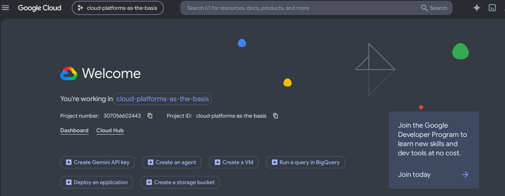

## 4. Ход работы

### 4.1. Создание сервисного аккаунта

В разделе **IAM & Admin → Service Accounts** создан аккаунт:

- **Имя и ID:** esolozhenkina-sa-lab1;
- **Адрес:** esolozhenkina-sa-lab1@cloud-platforms-as-the-basis.iam.gserviceaccount.com;
- **Описание:** Service account for ITMO Lab 1.

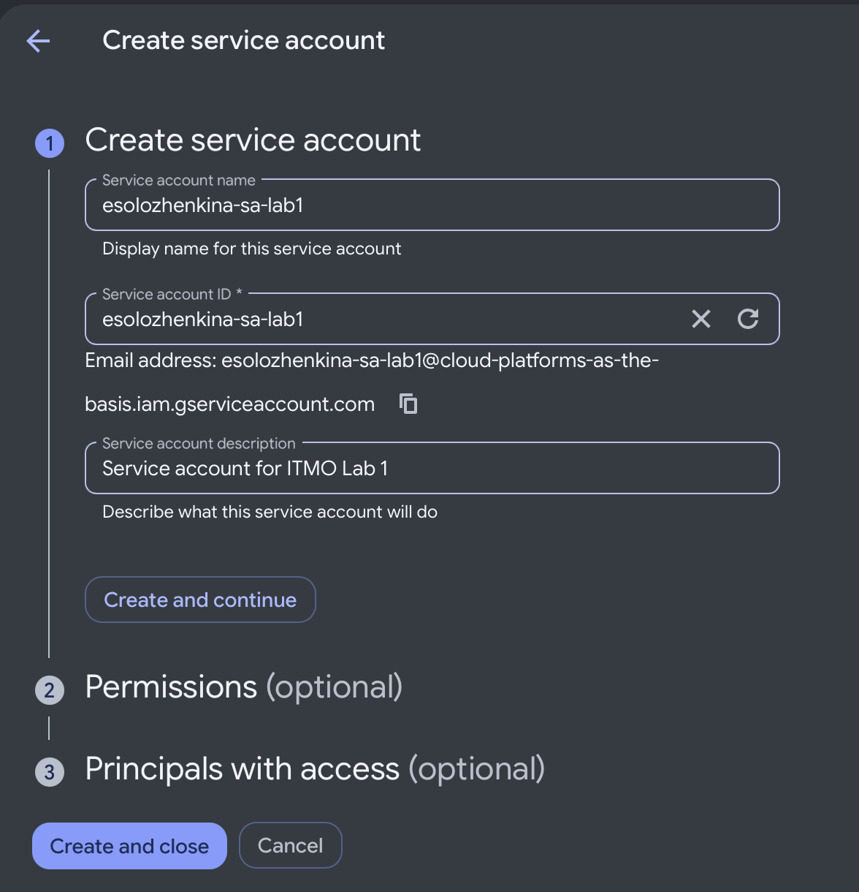

На этапе выдачи разрешений назначена роль **Storage Admin**. Она даёт широкие полномочия по управлению бакетами и объектами Cloud Storage, включая чтение файлов. Выбор этой роли соответствует заданию лабораторной работы.

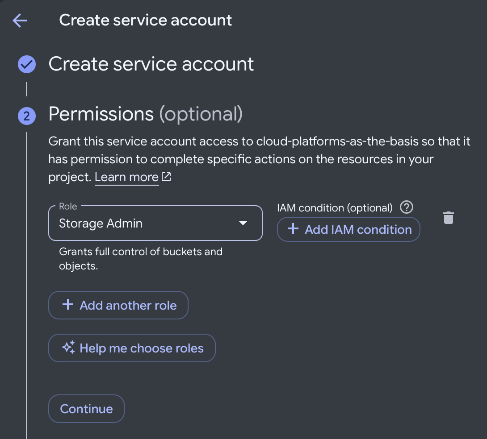

### 4.2. Настройка и запуск Compute Engine

В **Compute Engine → VM instances** создана виртуальная машина со следующими параметрами:

| Параметр | Значение |
| --- | --- |
| Имя | esolozhenkina-vm-lab1 |
| Регион и зона | us-central1 (Iowa), us-central1-a |
| Серия и тип | E2, e2-micro |
| Оперативная память | 1 ГБ |
| Модель предоставления | Spot |
| Операционная система | Debian GNU/Linux 13 (trixie) |
| Загрузочный диск | Balanced Persistent Disk, 10 ГБ |
| Прикреплённый сервисный аккаунт | esolozhenkina-sa-lab1 |
| OAuth access scopes | Allow full access to all Cloud APIs |
| Автоматические резервные копии | No backups |

**e2-micro** достаточно для запуска терминала и копирования небольших файлов. **Spot** снижает стоимость вычислений, но экземпляр может быть остановлен провайдером при нехватке свободной мощности.

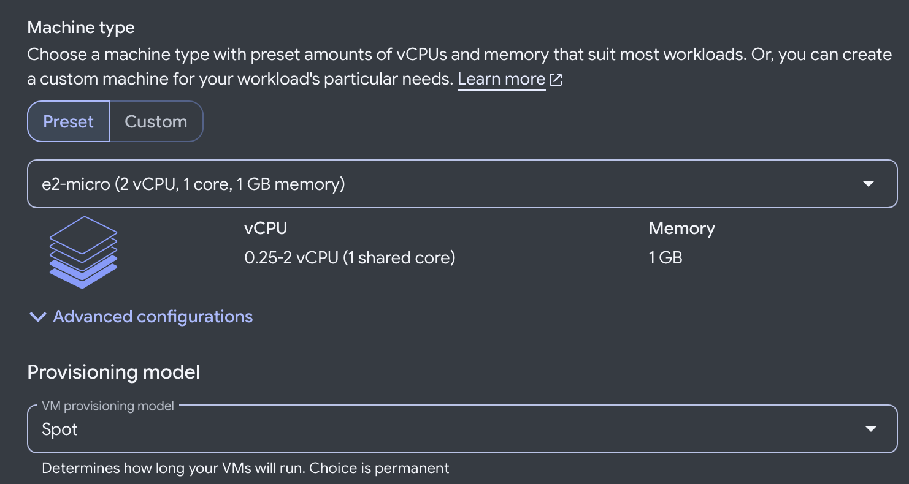

Выбранный сервисный аккаунт позволяет приложениям на VM проходить аутентификацию в Google Cloud. Настройка **Allow full access to all Cloud APIs** задаёт широкий OAuth scope, однако фактические действия по-прежнему ограничены IAM-ролями аккаунта.

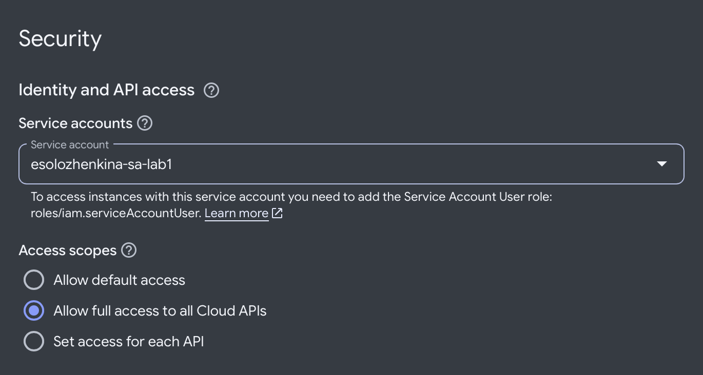

Загрузочный образ — Debian GNU/Linux 13 на диске объёмом 10 ГБ. Для временного учебного экземпляра отключено автоматическое создание снимков: оно не требуется для данных, которые будут удалены после работы.

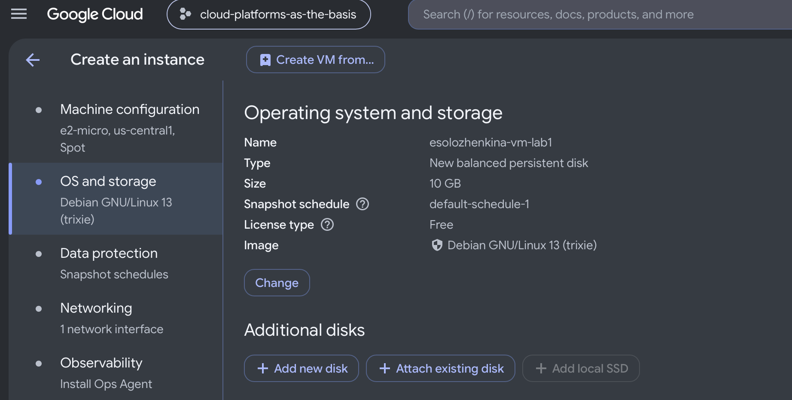

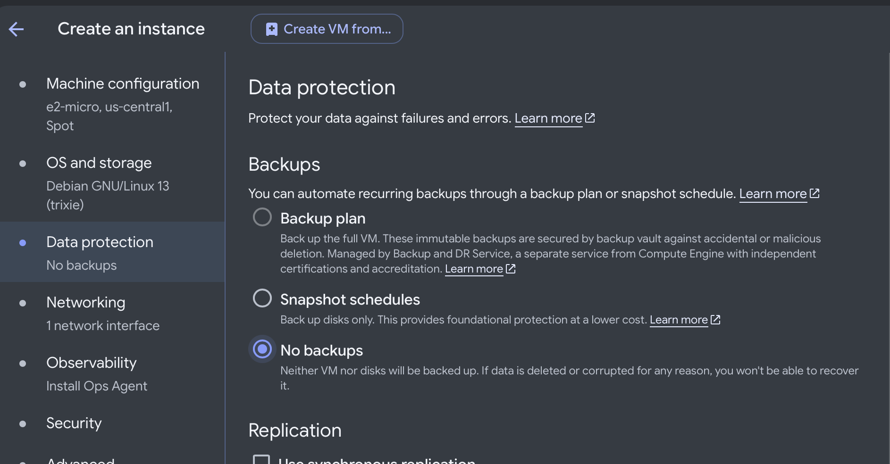

После создания VM появилась в списке со статусом работающей машины.

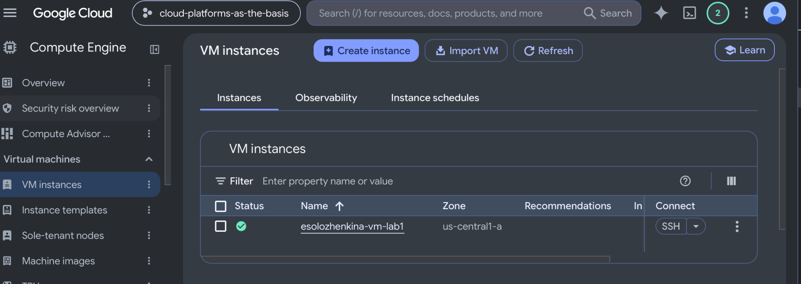

### 4.3. SSH и проверка сервисного аккаунта

Через кнопку **SSH** было открыто защищённое подключение к виртуальной машине Debian в браузере.

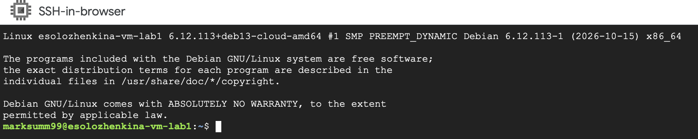

Для проверки активной идентичности выполнена команда:

~~~bash
gcloud auth list
~~~

Звёздочкой в выводе отмечен активный аккаунт **esolozhenkina-sa-lab1@cloud-platforms-as-the-basis.iam.gserviceaccount.com**. Следовательно, команды gcloud на VM выполняются от имени прикреплённого сервисного аккаунта, а не личного Google-аккаунта пользователя.

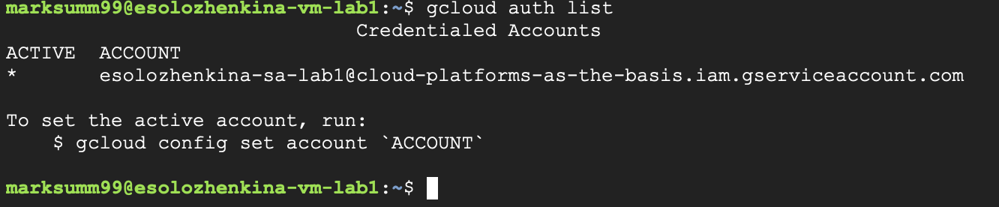

### 4.4. Поиск бакета и скачивание файлов

Получен список бакетов:

~~~bash
gcloud storage ls
~~~

В результате обнаружен **gs://lab1-bucket-itmo/**.

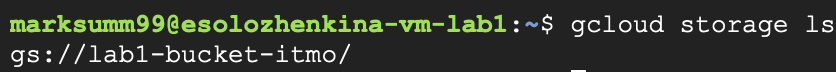

Просмотрено содержимое:

~~~bash
gcloud storage ls gs://lab1-bucket-itmo/
~~~

В хранилище находятся объекты **pic1.jpg**, **pic2.jpg** и **pic3.jpeg**.

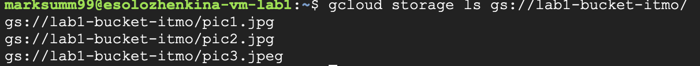

Создана локальная папка и выполнено скачивание всех трёх файлов:

~~~bash
mkdir -p ~/lab1-files
gcloud storage cp "gs://lab1-bucket-itmo/*" ~/lab1-files/
~~~

Команда завершилась сообщением **Completed files 3/3 | 1.5MiB/1.5MiB**. Объекты скопированы из Cloud Storage на локальный диск VM.

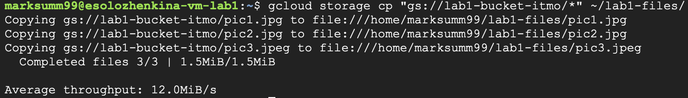

По требованию методички проверено содержимое папки:

~~~bash
ls -lah ~/lab1-files/
~~~

| Файл | Размер |
| --- | ---: |
| pic1.jpg | 228K |
| pic2.jpg | 487K |
| pic3.jpeg | 858K |

Ключи команды: **-l** выводит подробные сведения, **-a** включает скрытые элементы, **-h** показывает размеры в удобных единицах. Строки с точками «.» и «..» относятся к текущему и родительскому каталогам.

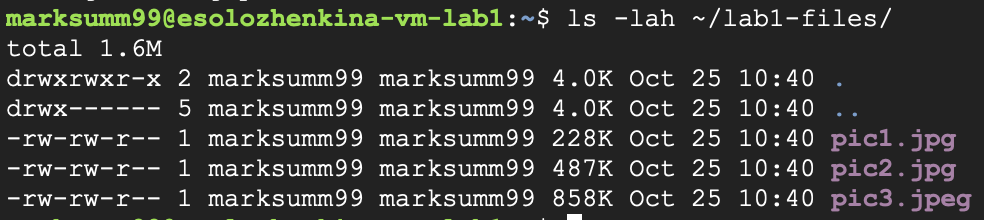

### 4.5. Замена IAM-роли

В **IAM & Admin → IAM** подтверждена первоначальная роль сервисного аккаунта **Storage Admin**.

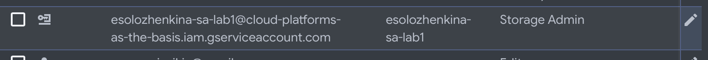

Она была **заменена**, а не дополнена, ролью **Compute Viewer**. Роль Compute Viewer предназначена для просмотра информации о вычислительных ресурсах и сама по себе не содержит разрешение storage.objects.get, необходимое для чтения объектов Cloud Storage.

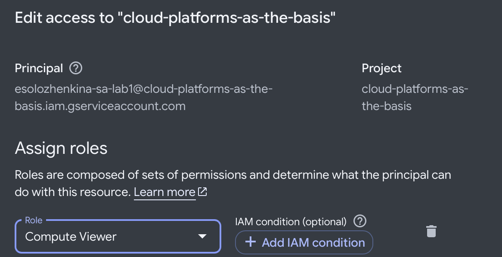

В IAM после сохранения отображается **Compute Viewer**.

В новой пустой локальной папке повторена операция копирования:

~~~bash
mkdir -p ~/lab1-files-after
gcloud storage cp "gs://lab1-bucket-itmo/*" ~/lab1-files-after/
~~~

**Фактический результат:** копирование снова успешно, **Completed files 3/3 | 1.5MiB/1.5MiB**. Ошибки Permission denied или HTTP 403 не возникло.

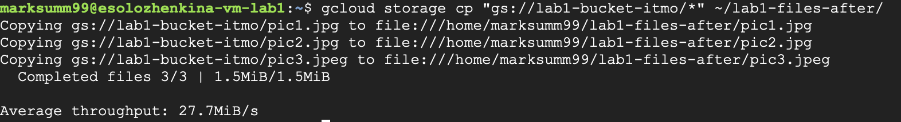

### 4.6. Дополнительная проверка публичного доступа

В качестве возможных причин повторного успеха рассматривались задержка распространения IAM-изменений и наличие других разрешений на доступ к файлам. Для проверки доступности объекта без учётных данных выполнен обычный анонимный HTTP-запрос:

~~~bash
curl -s -o /dev/null -w 'HTTP %{http_code}\n' https://storage.googleapis.com/lab1-bucket-itmo/pic1.jpg
~~~

Результат **HTTP 200** означает, что объект pic1.jpg был доступен для чтения без токена Google Cloud.

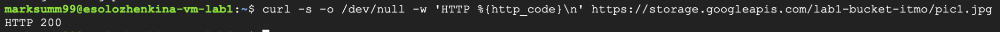

Аналогично проверены остальные объекты:

~~~bash
for file in pic1.jpg pic2.jpg pic3.jpeg; do
  curl -s -o /dev/null -w "$file: %{http_code}\n" \
    "https://storage.googleapis.com/lab1-bucket-itmo/$file"
done
~~~

| Объект | HTTP-код анонимного запроса |
| --- | --- |
| pic1.jpg | 200 |
| pic2.jpg | 200 |
| pic3.jpeg | 200 |

Таким образом, **все три объекта доступны анонимно**. Их публичная доступность объясняет возможность успешного скачивания после смены роли. По этим запросам нельзя однозначно определить, каким именно механизмом выдан публичный доступ (IAM-политика бакета или ACL объектов); настройки преподавательского бакета не изменялись.

Следовательно, эксперимент с этими конкретными объектами **не доказывает**, что Compute Viewer предоставляет доступ к Cloud Storage. Для изолированной проверки ожидаемого отказа 403 нужен приватный бакет без дополнительных разрешений, обеспечивающих чтение.

### 4.7. Очистка созданных ресурсов

После выполнения эксперимента удалена VM **esolozhenkina-vm-lab1**. Диалог удаления явно указывал, что одновременно удаляется её загрузочный диск.

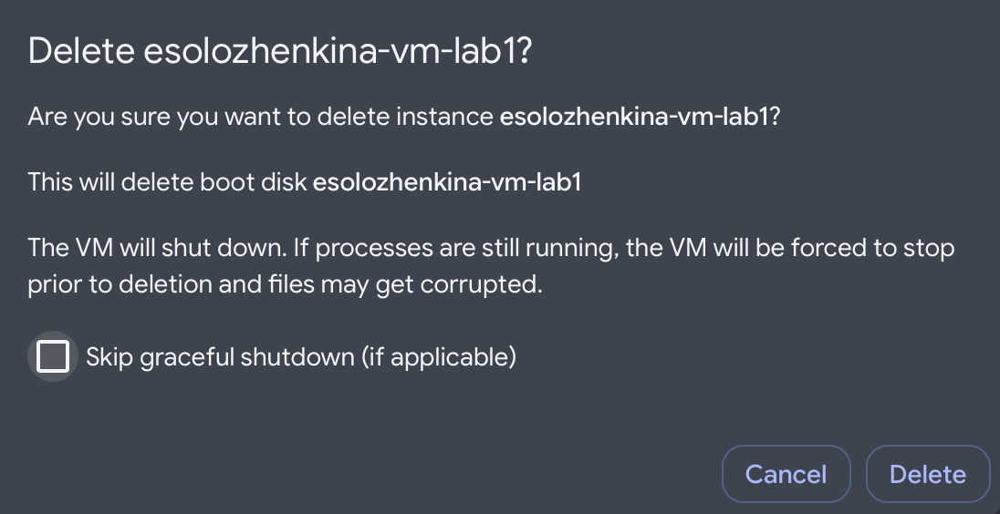

После удаления проверен раздел дисков Compute Engine: диск с именем **esolozhenkina-vm-lab1** отсутствует.

Созданный для лабораторной сервисный аккаунт **esolozhenkina-sa-lab1** также выбран для удаления. На рисунке показан диалог подтверждения операции; системные аккаунты и аккаунты других студентов не затрагивались.

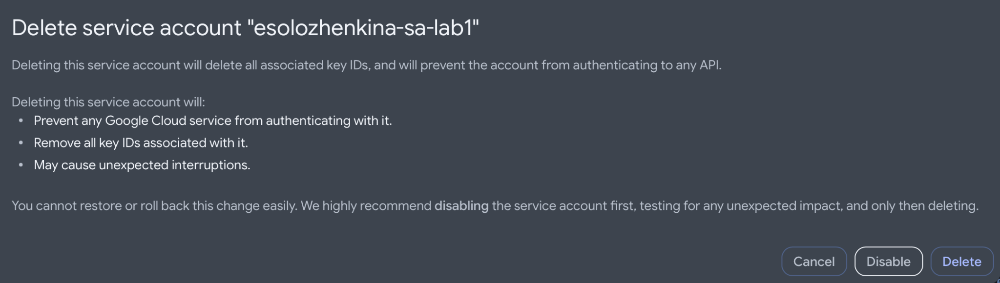

## 5. Результаты

| Требование | Результат |
| --- | --- |
| Service Account со Storage Admin | Выполнено |
| VM e2-micro в режиме Spot | Выполнено |
| Поиск бакета lab1-bucket-itmo | Выполнено |
| Скачивание трёх файлов | Выполнено, 3/3 |
| Проверка ls -lah | Выполнено |
| Смена роли на Compute Viewer | Выполнено |
| Повторная загрузка | Выполнено, снова 3/3 |
| Анализ доступа | Выявлена анонимная доступность всех трёх объектов |
| Удаление VM и загрузочного диска | Выполнено |

## 6. Вывод

В лабораторной работе изучены сервисные аккаунты и роли IAM, создана Spot VM e2-micro в Compute Engine, организовано SSH-подключение и выполнено копирование трёх файлов из Cloud Storage посредством gcloud. Наличие локальных файлов подтверждено командой ls -lah.

При замене роли Storage Admin на Compute Viewer повторная загрузка неожиданно осталась успешной. Дополнительная проверка дала HTTP 200 при анонимном запросе к каждому из трёх файлов. Это показывает, что фактическая доступность объектов определяется совокупностью разрешений, включая публичный доступ, а не только ролью одного сервисного аккаунта. Для проверки запрета чтения требуется непубличный ресурс.

После практической части виртуальная машина и её загрузочный диск удалены, чтобы не оставлять тарифицируемые ресурсы в учебном проекте.

## 7. Источники

1. [ИТМО — лабораторная № 1](https://ex-itmo-ict-faculty.github.io/cloud-platforms-as-the-basis-of-technology-entrepreneurship/education/labs2023-2024/lab1/lab1/).
2. [ИТМО — правила оформления отчётов](https://ex-itmo-ict-faculty.github.io/cloud-platforms-as-the-basis-of-technology-entrepreneurship/education/labs2023-2024/reportdesign/).
3. [Google Cloud — Service Accounts для Compute Engine](https://docs.cloud.google.com/compute/docs/access/service-accounts).
4. [Google Cloud — IAM-роли Cloud Storage](https://docs.cloud.google.com/storage/docs/access-control/iam-roles).
5. [Google Cloud — Spot VMs](https://docs.cloud.google.com/compute/docs/instances/spot).
6. [Google Cloud — публичный доступ к объектам](https://docs.cloud.google.com/storage/docs/access-control/making-data-public).
