# Лабораторная работа № 2. Исследование Cloud Run

**University:** [ИТМО](https://itmo.ru/ru/)  
**Faculty:** ФТМИ  
**Course:** [Облачные платформы как основа технологического предпринимательства](https://ex-itmo-ict-faculty.github.io/cloud-platforms-as-the-basis-of-technology-entrepreneurship/)  
**Year:** 2026/2027  
**Group:** U4225  
**Author:** Соложенкина Елизавета  
**Lab:** Lab2  
**Date of create:** 25.10.2026  
**Date of finished:**

## 1. Цель работы

Изучить работу **Google Cloud Run** на практике: развернуть контейнеризированное веб-приложение с минимальными ресурсами, проверить его доступность, исследовать журналы и метрики, изменить порт контейнера, поработать с ревизиями и распределением трафика, а затем удалить созданные ресурсы.

## 2. Задачи

1. Создать сервис Cloud Run на основе демонстрационного контейнера **Hello** с минимальными ресурсами.
2. Открыть публичный адрес сервиса и проверить ответ веб-приложения.
3. Изучить логи запуска и обработки HTTP-запросов, проанализировать основные метрики.
4. Изменить порт контейнера с **8080** на **8090**, выполнить новое развёртывание и проверить результат.
5. Распределить трафик между двумя ревизиями, выполнить возврат к первой ревизии и восстановить направление трафика на последнюю.
6. Удалить созданный сервис и зафиксировать результаты экспериментов.

Работа выполнена в учебном проекте **`cloud-platforms-as-the-basis`**. Для экспериментов использовался отдельный сервис с индивидуальным именем; ресурсы других участников не изменялись.

## 3. Используемые сервисы и понятия

| Сервис или понятие | Назначение |
| --- | --- |
| Google Cloud Run | Запуск контейнеризированных приложений без ручного администрирования сервера |
| Artifact Registry | Хранение и предоставление образов контейнеров |
| Контейнерный образ | Подготовленный пакет приложения с необходимым окружением |
| Ревизия (revision) | Неизменяемая версия конфигурации и развёртывания сервиса Cloud Run |
| Распределение трафика | Направление заданных долей запросов на разные ревизии |
| Cloud Logging | Просмотр записей о запуске контейнера и HTTP-запросах |
| Cloud Monitoring | Наблюдение за задержкой запросов, числом экземпляров и загрузкой ресурсов |

Для лабораторной работы выбран официальный тестовый образ **`us-docker.pkg.dev/cloudrun/container/hello`**. Его достаточно для проверки функций платформы; разрабатывать собственное приложение для этого задания не потребовалось.

## 4. Ход работы

### 4.1. Создание сервиса Cloud Run

В консоли Google Cloud открыт раздел **Cloud Run → Services → Create service**. Выбран вариант создания сервиса из существующего контейнерного образа.

| Параметр | Значение |
| --- | --- |
| Проект | `cloud-platforms-as-the-basis` |
| Имя сервиса | `esolozhenkina-run-lab2` |
| Образ контейнера | `us-docker.pkg.dev/cloudrun/container/hello` |
| Регион | `europe-west1` (Бельгия) |
| Доступ | Публичный, без обязательной авторизации |
| Входящий трафик (Ingress) | `All` |
| Модель тарификации | `Request-based` |
| Масштабирование | Автоматическое |
| Минимальное количество экземпляров | 0 |
| Первоначальное максимальное количество экземпляров | 1 |
| CPU | 1 vCPU |
| Оперативная память | 512 MiB |
| Порт контейнера | 8080 |
| Тайм-аут запроса | 300 секунд |
| Максимальная одновременность | 80 запросов |
| Startup CPU boost | Отключён |

Имя сервиса и регион зафиксированы в форме создания. Использован демонстрационный образ Hello, подходящий для проверки HTTP-доступности.

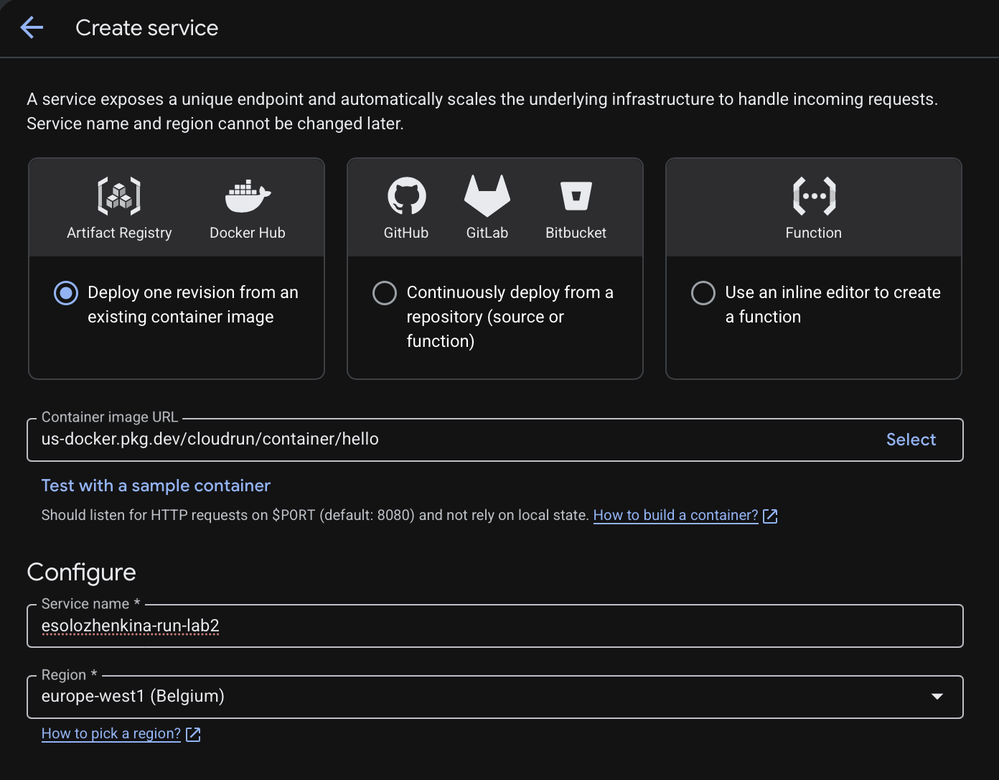

В настройках выбран публичный доступ, тарификация по запросам и автоматическое масштабирование от нуля до одного экземпляра. Минимум **0** позволяет Cloud Run уменьшать число экземпляров при отсутствии запросов, хотя остановка не обязательно происходит мгновенно.

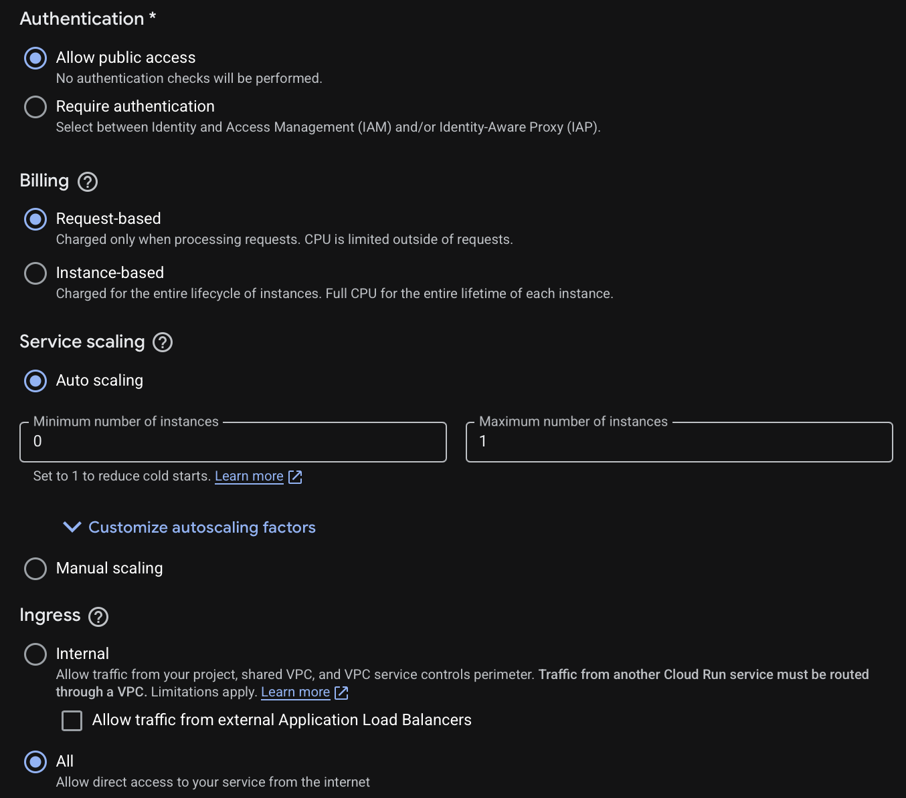

Для контейнера заданы порт **8080**, **1 vCPU** и **512 MiB** оперативной памяти. Дополнительный GPU и временный диск не подключались. Ускорение CPU при запуске (**Startup CPU boost**) было отключено; в сведениях об успешно созданной ревизии это отображается как `Disabled`.

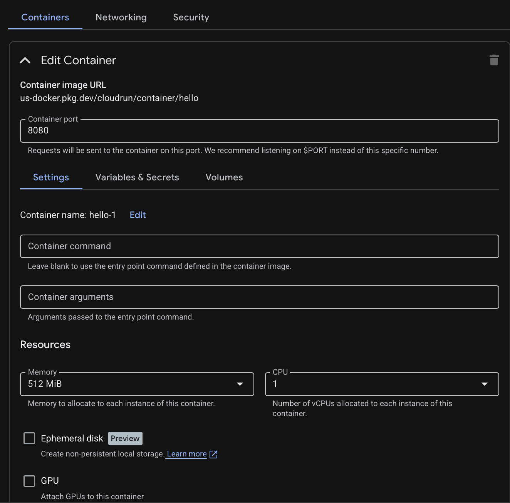

### 4.2. Первое развёртывание и проверка доступности

После создания Cloud Run успешно выполнил три операции: создание сервиса, создание ревизии и настройку маршрутизации трафика.

Первая ревизия получила идентификатор **`esolozhenkina-run-lab2-00001-ndh`** и **100 %** трафика. Её контейнер работал с портом **8080**.

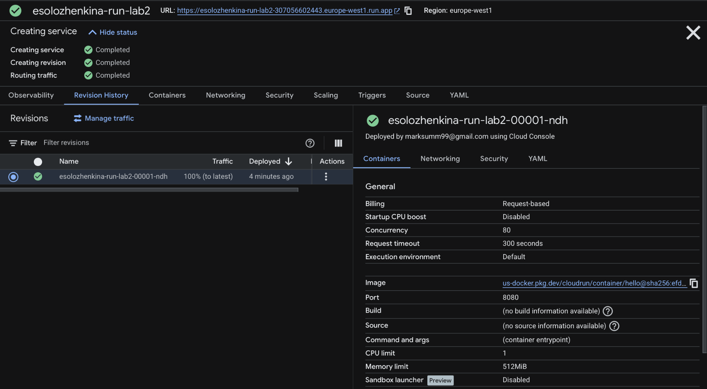

Cloud Run предоставил публичный адрес:

`https://esolozhenkina-run-lab2-307056602443.europe-west1.run.app`

При переходе по нему открылась стандартная страница **Hello from Cloud Run** с сообщением об успешном развёртывании контейнера. Это подтверждает, что платформа запустила приложение и смогла передать ему HTTP-запрос.

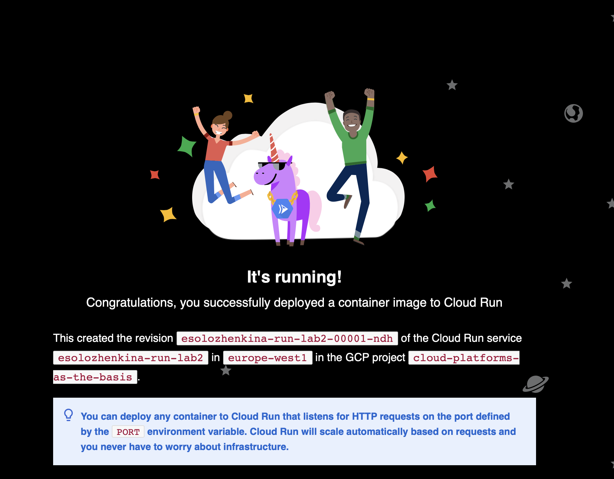

**Примечание:** URL указан как результат эксперимента. После завершения работы сервис удалён, поэтому адрес больше не является действующим сайтом.

### 4.3. Анализ логов

В разделе **Observability → Logs** изучены события запуска и обращения к сервису.

Зафиксированы:

- создание сервиса и запуск первого экземпляра;
- сообщение контейнера о готовности принимать HTTP-запросы на порту **8080**;
- успешная стартовая TCP-проверка (**STARTUP TCP probe succeeded**) с первой попытки;
- запросы `GET /` и загрузка ресурсов страницы со статусом **200 OK**;
- длительность отдельных запросов около **2–9 мс** в наблюдаемом фрагменте журнала.

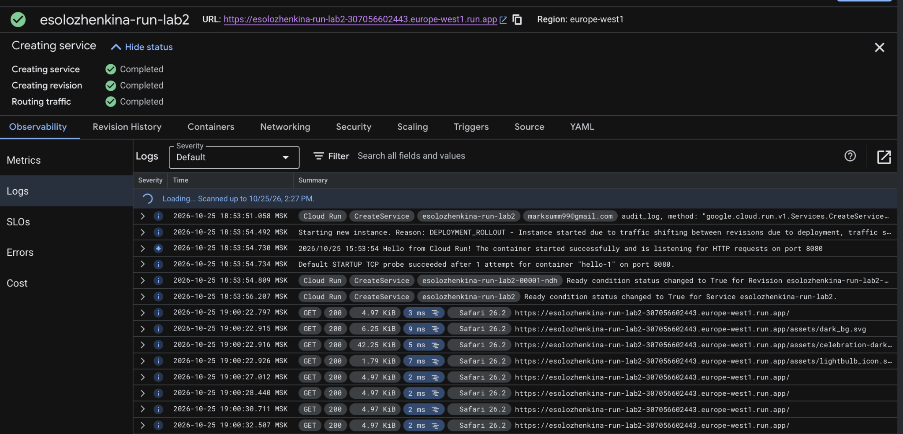

HTTP-код **200** означает успешную обработку запроса. В показанном фрагменте журнала не обнаружено HTTP-ошибок. Логи также подтвердили, что при первом развёртывании контейнер слушал порт **8080**.

### 4.4. Анализ метрик

В разделе **Observability → Metrics** установлен интервал **«Последние 15 минут»**: при небольшой тестовой нагрузке он позволяет увидеть изменения на графиках более отчётливо, чем суточный интервал.

| Показатель | Наблюдение |
| --- | --- |
| Request count | Небольшая серия запросов, после прекращения тестирования активность снизилась до нуля |
| Коды ответов | В показанной серии присутствуют ответы класса **2xx** |
| Request latencies | Около **5 мс** для 50-го перцентиля и **9–10 мс** для верхних перцентилей |
| End-to-end request latency | Около **21 мс** для 50-го перцентиля и **28 мс** для верхних перцентилей |

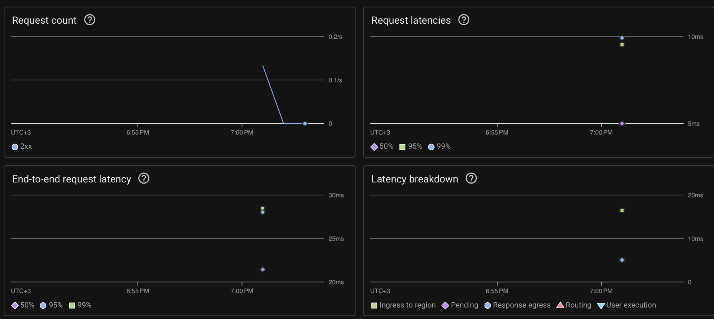

**Request latency** описывает задержку на стороне сервиса, а **end-to-end latency** отражает более полный путь запроса через инфраструктуру. Поэтому значения метрик различаются.

Дополнительно исследованы показатели использования ресурсов:

- **Container instance count:** при обработке запросов наблюдался активный экземпляр; в другие моменты экземпляр отображался как неактивный (`idle`).
- **Billable container instance time:** показаны короткие всплески времени, учитываемого при тарификации по запросам.
- **Container CPU utilization:** после начальной активности показатель снизился приблизительно до **0,5–1 %**.
- **Container memory utilization:** использование памяти оставалось около **4,5–5 %**.

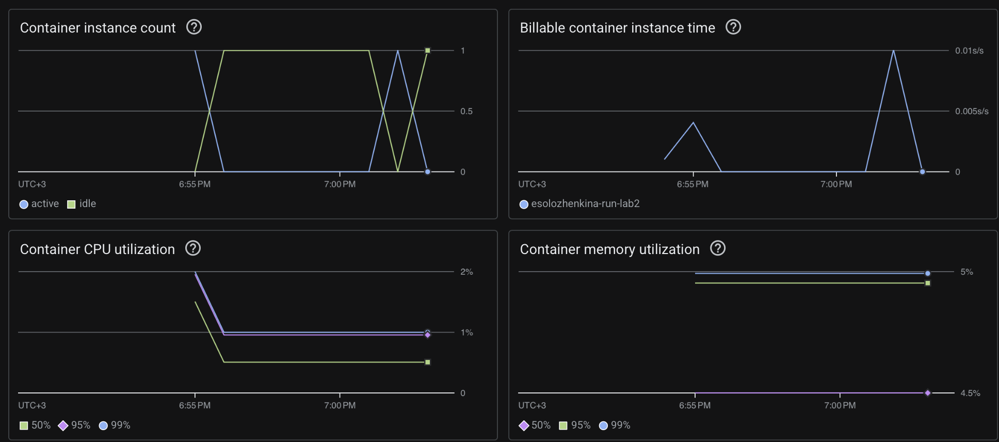

Наблюдения соответствуют простой тестовой странице, которая не выполняет тяжёлых вычислений. При этом интервал короткий, а запросов мало, поэтому по этим графикам **нельзя** делать выводы о производительности приложения при высокой нагрузке или о точной стоимости эксплуатации.

### 4.5. Изменение порта с 8080 на 8090

В разделе настроек контейнера значение порта изменено с **8080** на **8090**.

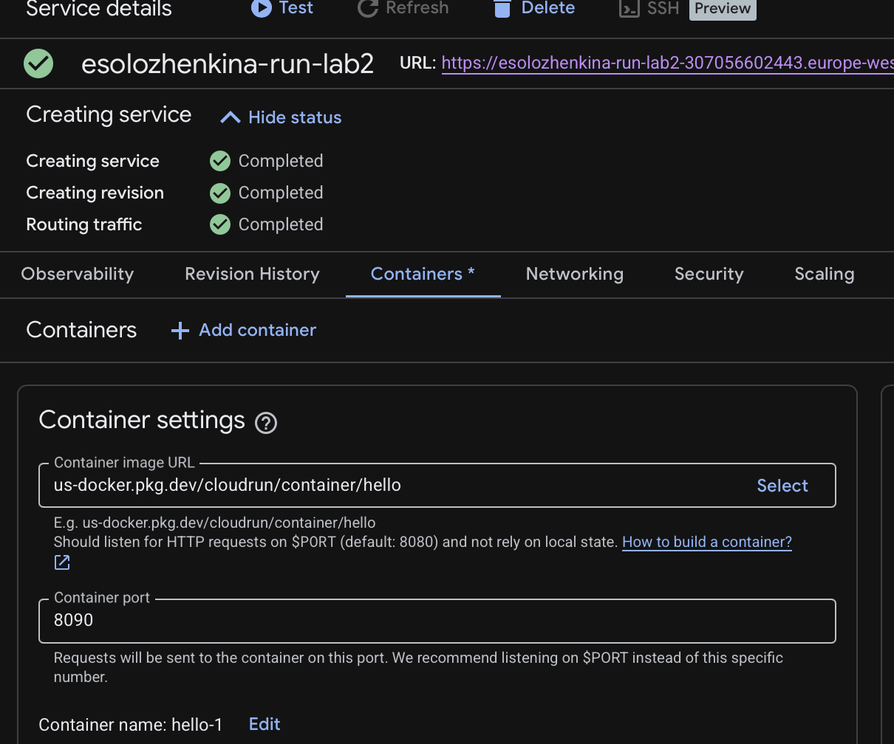

Перед публикацией консоль отобразила сравнение параметров: `Current: 8080`, `New: 8090`.

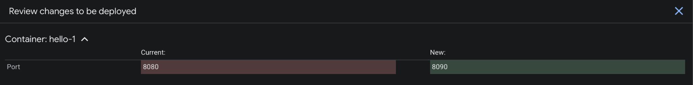

При сохранении конфигурации Cloud Run создал **вторую ревизию** — **`esolozhenkina-run-lab2-00002-ns5`**. Новая ревизия получила **100 %** трафика, первая — **0 %**.

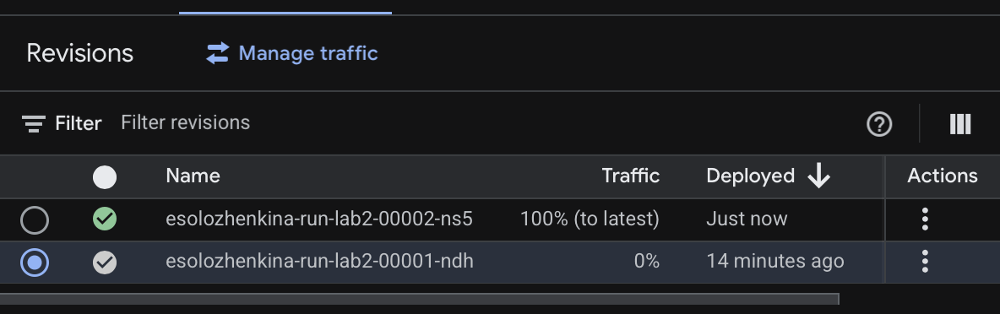

После изменения порта та же страница Hello продолжила работать по прежнему внешнему адресу. Такое поведение возможно, поскольку тестовый контейнер Cloud Run использует предоставляемую платформой переменную окружения **`PORT`** и способен слушать заданный порт. Следовательно, **смена порта сама по себе не обязана приводить к ошибке**: результат зависит от того, как реализован контейнер.

### 4.6. Распределение трафика между ревизиями

В разделе **Revision History → Manage traffic** предпринята попытка направить по **50 %** запросов на каждую из двух ревизий.

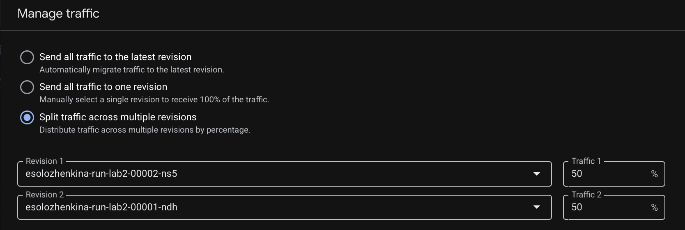

При первой попытке консоль вернула ошибку:

> `service level max instances must be greater than or equal to the number of targets receiving traffic`

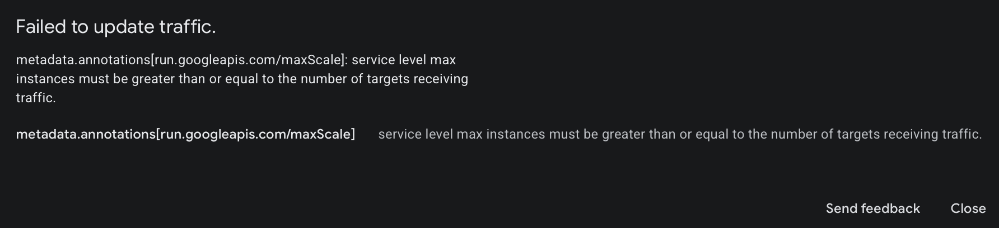

**Причина:** первоначально в настройках сервиса было установлено максимальное число экземпляров **1**, но трафик предполагалось направлять на **две** ревизии. В данной конфигурации платформа потребовала, чтобы лимит экземпляров на уровне сервиса был не меньше количества получателей трафика.

Для исправления настройки максимальное количество экземпляров сервиса изменено на **2**. После этого схема **50 % / 50 %** была успешно применена: обе ревизии получили трафик и имели статус готовности.

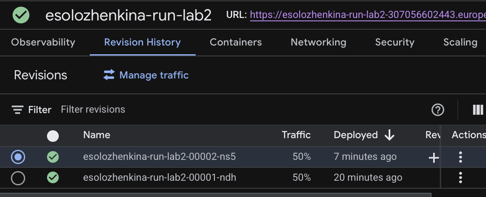

Значение **50 %** обозначает целевую долю распределения запросов; оно не гарантирует, что при очень малом числе обращений фактическое количество запросов к каждой ревизии окажется строго одинаковым.

### 4.7. Переключение трафика и возврат к предыдущей версии

Следующий эксперимент — возвращение трафика на исходную ревизию:

1. Первой ревизии `00001-ndh` с портом **8080** назначено **100 %** трафика.
2. Второй ревизии `00002-ns5` с портом **8090** назначено **0 %**.

Изменение маршрутизации выполнено успешно. Этот приём можно использовать для **отката** при проблемах после обновления, не удаляя новую ревизию.

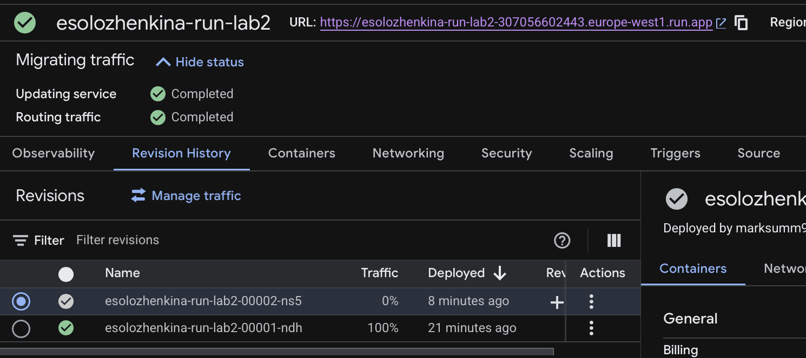

После этого трафик снова перенаправлен на последнюю ревизию: **0 %** на `00001-ndh` и **100 %** на `00002-ns5`.

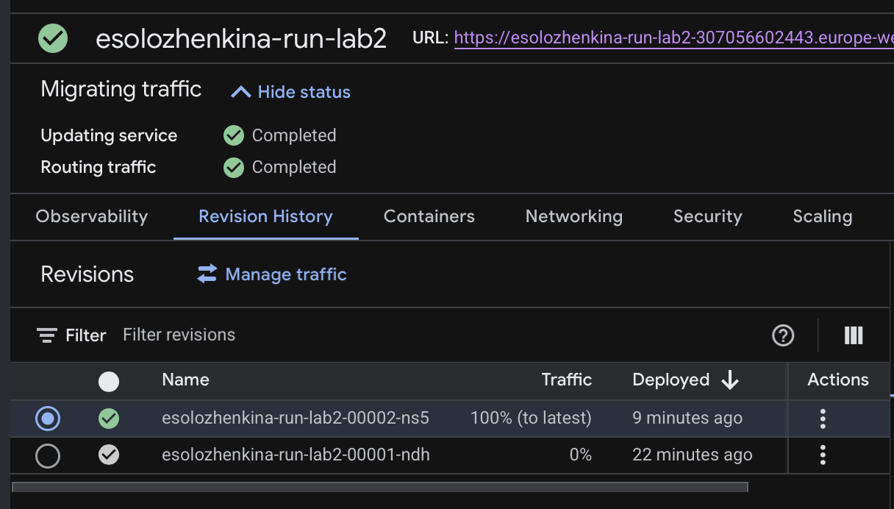

**Важно:** ревизии оставались доступными для управления маршрутизацией независимо от того, получали ли они пользовательский трафик. Изменение процентного распределения не создавало новый контейнерный образ и не требовало удалять предыдущую ревизию.

### 4.8. Удаление созданного сервиса

После завершения экспериментов удалён сервис **`esolozhenkina-run-lab2`**. Для подтверждения удаления в диалоговом окне было введено его точное имя.

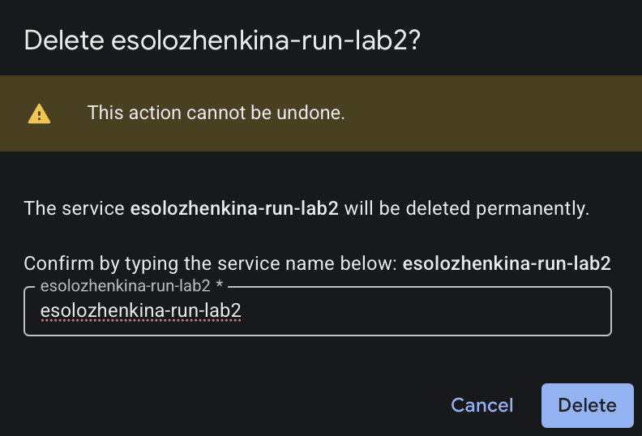

Консоль показала системное уведомление **`Service esolozhenkina-run-lab2 deleted`**, что подтверждает завершение операции.

Сервис и относящиеся к нему ревизии удалены. Созданных для этой работы постоянно работающих сервисов Cloud Run не осталось. При этом удаление сервиса не означает автоматического удаления общего учебного проекта и его ресурсов, принадлежащих другим участникам.

## 5. Результаты экспериментов

### 5.1. Сравнение ревизий

| Параметр | Первая ревизия | Вторая ревизия |
| --- | --- | --- |
| Идентификатор | `00001-ndh` | `00002-ns5` |
| Контейнерный образ | Hello | Hello |
| Порт | **8080** | **8090** |
| Статус развёртывания | Успешно | Успешно |
| Результат наблюдения | Тестовый сервис работал | Тестовый сервис продолжил работать |

### 5.2. История распределения трафика

| Этап | Первая ревизия, 8080 | Вторая ревизия, 8090 | Результат |
| --- | ---: | ---: | --- |
| После создания сервиса | **100 %** | — | Первая ревизия обслуживает запросы |
| После смены порта | 0 % | **100 %** | Трафик направлен на новую ревизию |
| Первая попытка распределения | План 50 % | План 50 % | Ошибка при лимите `max instances = 1` |
| После увеличения лимита до 2 | **50 %** | **50 %** | Распределение применено |
| Возврат к старой версии | **100 %** | 0 % | Успешное переключение |
| Повторный переход на новую | 0 % | **100 %** | Успешное переключение |

**Главный результат опыта со сменой порта:** Cloud Run создал отдельную ревизию, но сам сервис сохранил внешний URL и работоспособность. Состояние сервиса зависит не только от числового значения порта, но и от того, способен ли контейнер принимать запросы на порту, который ему задаёт платформа.

## 6. Вывод

В лабораторной работе создан и протестирован сервис **Google Cloud Run** на базе демонстрационного контейнера Hello. Приложение было опубликовано по HTTPS, после чего изучены журналы запуска, ответы HTTP **200 OK**, задержки обработки запросов и потребление вычислительных ресурсов.

Изменение порта **8080 → 8090** привело к появлению новой ревизии без изменения внешнего адреса сервиса. Разделение трафика между двумя версиями позволило исследовать ограничение `max instances`: при лимите **1** распределение на две ревизии не применилось, а после изменения лимита на **2** конфигурация **50/50** была сохранена. Также успешно выполнено переключение 100 % трафика на старую ревизию и обратно.

Все операции эксперимента зафиксированы скриншотами. По окончании работы учебный сервис **удалён**, что соответствует требованию очистить созданные облачные ресурсы.

## 7. Использованные материалы

1. [Правила оформления лабораторных работ](https://ex-itmo-ict-faculty.github.io/cloud-platforms-as-the-basis-of-technology-entrepreneurship/education/labs2023-2024/reportdesign/).
2. [Google Cloud Run — развёртывание контейнера](https://cloud.google.com/run/docs/deploying).
3. [Google Cloud Run — настройка контейнеров](https://cloud.google.com/run/docs/configuring/services/containers).
4. [Google Cloud Run — переменная PORT и контракт контейнера](https://cloud.google.com/run/docs/container-contract).
5. [Google Cloud Run — распределение трафика между ревизиями](https://cloud.google.com/run/docs/rollouts-rollbacks-traffic-migration).
6. [Google Cloud Run — мониторинг и метрики](https://cloud.google.com/run/docs/monitoring).
