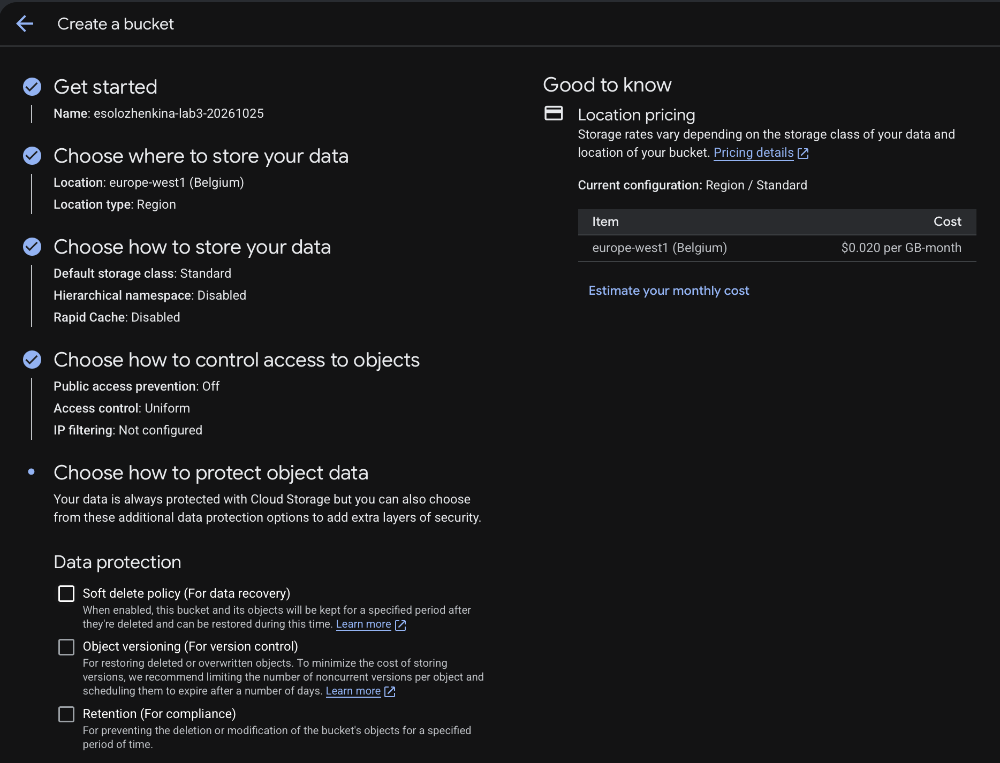
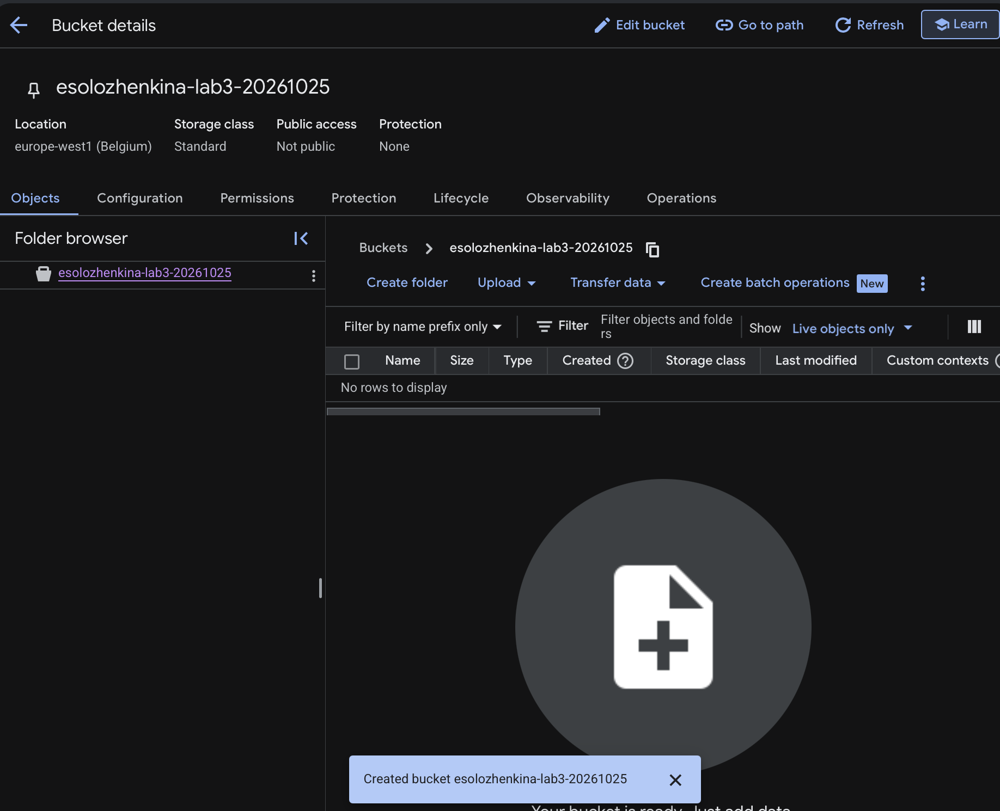
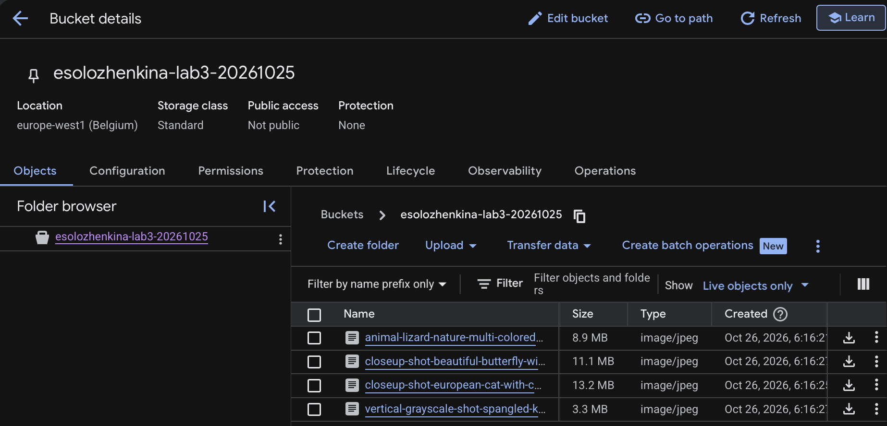
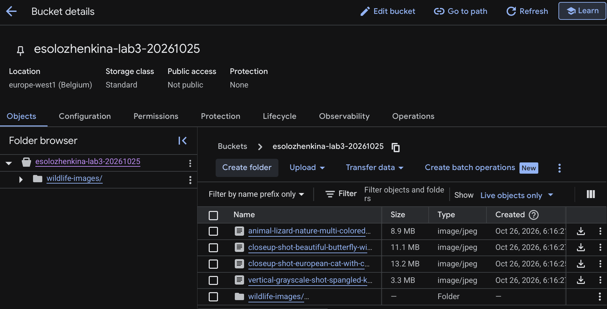
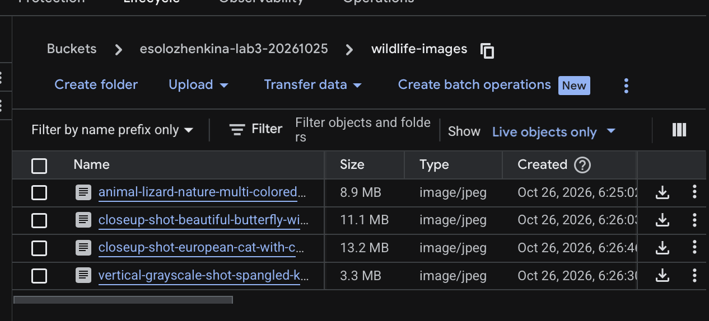
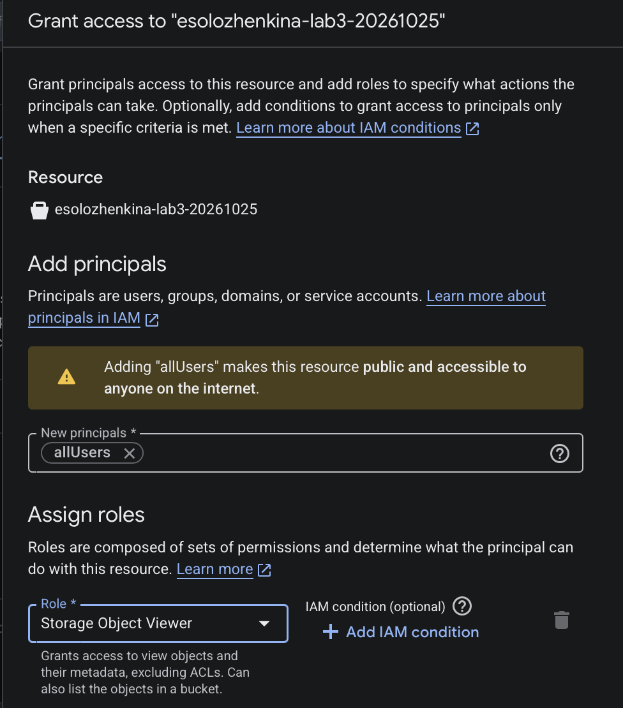
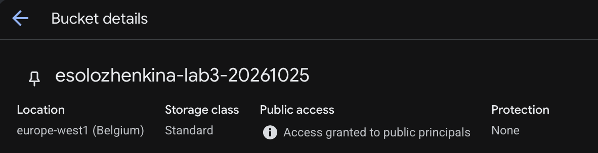
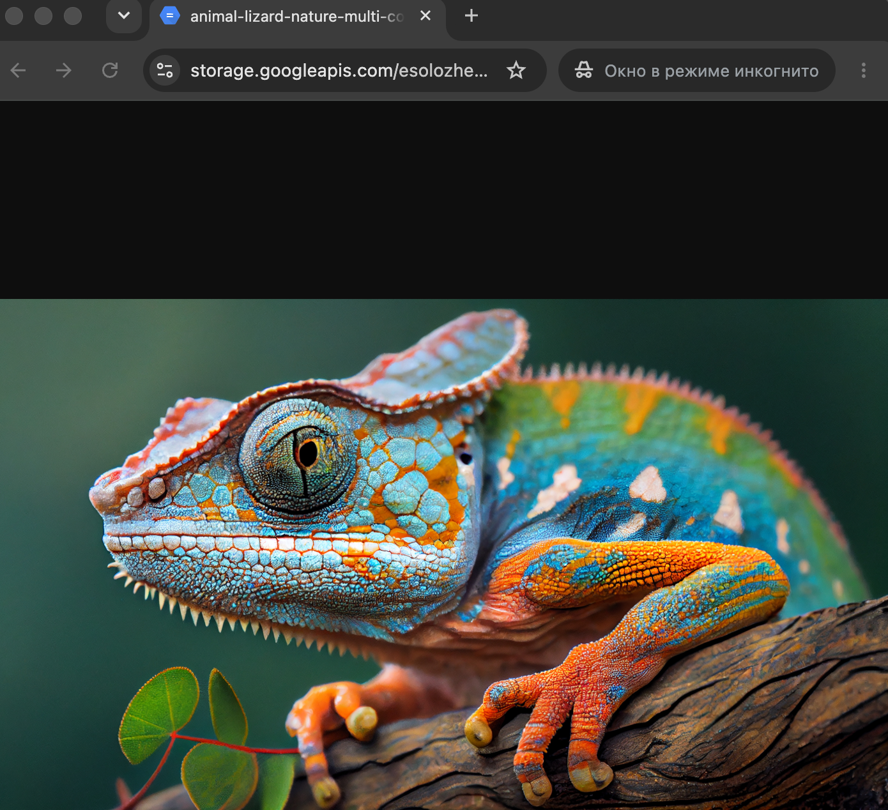
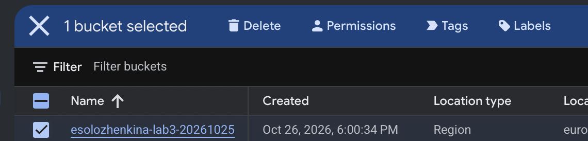
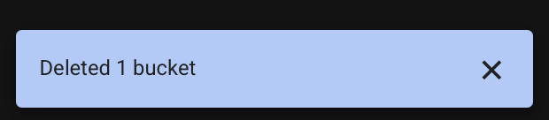

# Лабораторная работа № 3 «Исследование Cloud Storage»

**Университет:** Университет ИТМО  
**Факультет:** ФТМИ  
**Курс:** Облачные платформы как основа технологического предпринимательства  
**Учебный год:** 2026/2027  
**Группа:** U4225  
**Автор:** Соложенкина Елизавета  
**Дата выполнения:** 26.10.2026  
**Дата защиты:** —

## Цель работы

Ознакомиться с основными принципами работы облачного хранилища, сопоставить блочную, файловую и объектную модели хранения, изучить возможности Google Cloud Storage. На практике создать бакет, загрузить и упорядочить изображения, предоставить публичный доступ, получить ссылку на объект и удалить созданные ресурсы.

## Используемые средства

- Платформа **Google Cloud** и веб-консоль **Google Cloud Console**.
- Сервис объектного хранения **Cloud Storage**.
- Существующий учебный проект `cloud-platforms-as-the-basis`.
- Браузер Google Chrome, включая режим инкогнито для проверки доступа.

## Теоретические сведения

**Облачное хранилище** позволяет хранить данные на инфраструктуре облачного провайдера и обращаться к ним через сеть, веб-консоль и программные интерфейсы.

| Модель хранения | Принцип работы | Применение |
| --- | --- | --- |
| Блочная | Данные представлены блоками, из которых формируется диск или том. | Диски виртуальных машин, базы данных. |
| Файловая | Данные расположены в общей файловой системе с каталогами и файлами. | Сетевые папки, совместная работа с файлами. |
| Объектная | Каждый объект имеет содержимое, уникальное имя (ключ) и метаданные. | Изображения, резервные копии, статические ресурсы сайтов. |

**Google Cloud Storage** — объектное хранилище. **Бакет** (bucket) — контейнер объектов, для которого задаются расположение, класс хранения и настройки доступа. При отключённом параметре *Hierarchical namespace* папки в обычном бакете представляют собой префиксы имён объектов. Например, путь `wildlife-images/photo.jpg` означает объект с таким ключом, а не файл на обычном диске.

Режим доступа **Uniform** предполагает управление разрешениями посредством **IAM** на уровне бакета. Специальный принципал `allUsers` обозначает любого пользователя Интернета, включая неавторизованных. Роль **Storage Object Viewer** разрешает читать и просматривать список объектов, но не изменять их.

## Ход работы

### 1. Создание бакета Cloud Storage

В Google Cloud Console выбран существующий учебный проект `cloud-platforms-as-the-basis`, в котором доступны необходимые разрешения. В разделе **Cloud Storage → Buckets** запущено создание нового бакета.

Введены следующие параметры:

| Параметр | Установленное значение |
| --- | --- |
| Имя | `esolozhenkina-lab3-20261025` |
| Тип расположения | `Region` |
| Регион | `europe-west1 (Belgium)` |
| Класс хранения | `Standard` |
| Hierarchical namespace | `Disabled` |
| Public access prevention | `Off` |
| Контроль доступа | `Uniform` |
| Soft delete / Versioning / Retention | Не включены |



После создания открылась страница пустого бакета. Первоначально статус доступа был **Not public**. Отключение *Public access prevention* только разрешает в дальнейшем настраивать публичный доступ, но не открывает бакет автоматически.



### 2. Загрузка изображений

С помощью меню **Upload** в корень бакета загружены четыре изображения формата JPEG: ящерица, бабочка, кошка и птица. После загрузки все четыре объекта отобразились в разделе **Objects**.

| Изображение | Формат | Размер в интерфейсе |
| --- | --- | --- |
| Ящерица | JPEG | 8,9 МБ |
| Бабочка | JPEG | 11,1 МБ |
| Кошка | JPEG | 13,2 МБ |
| Птица | JPEG | 3,3 МБ |



### 3. Создание папки и перемещение файлов

С помощью команды **Create folder** создана папка `wildlife-images`. Изначально она находилась в корне бакета рядом с четырьмя изображениями.



Для каждого объекта выполнено перемещение через его контекстное меню (**Move**) в папку `wildlife-images`. В результате все четыре изображения находятся внутри папки, а не в корне бакета.



Таким образом, полный ключ изображения ящерицы приобрёл вид `wildlife-images/animal-lizard-nature-multi-colored-close-up-generative-ai.jpg`.

### 4. Предоставление публичного доступа

На вкладке **Permissions** нажата кнопка **Grant access**. В поле **New principals** указан `allUsers`, а в списке ролей выбрана **Cloud Storage → Storage Object Viewer**. Разрешение назначено конкретно созданному учебному бакету, а не всему проекту.



После сохранения разрешений в заголовке бакета отобразилось сообщение **Access granted to public principals**, подтверждающее публичный доступ для просмотра объектов.



### 5. Получение ссылки и проверка доступности

С помощью контекстного меню одного из файлов получена прямая ссылка вида:

```text
https://storage.googleapis.com/esolozhenkina-lab3-20261025/wildlife-images/animal-lizard-nature-multi-colored-close-up-generative-ai.jpg
```

Ссылка открыта в **режиме инкогнито** Google Chrome, без входа в аккаунт Google. Изображение успешно загрузилось, что подтверждает доступность объекта для анонимного чтения.



**Примечание:** приведённая ссылка использовалась только для проверки. После удаления бакета на заключительном этапе она перестала быть действующей.

### 6. Удаление созданного ресурса

По завершении эксперимента открыт список **Cloud Storage → Buckets**. Выделен ровно один бакет с названием `esolozhenkina-lab3-20261025` и выбрана команда **Delete**.



В консоли получено подтверждение **Deleted 1 bucket**. Созданный в ходе работы бакет удалён. Другие ресурсы общего учебного проекта не затрагивались.



## Результаты

Выполнены все практические задания:

1. Выбран существующий учебный проект с разрешениями для работы.
2. Создан бакет Cloud Storage в регионе `europe-west1` с классом хранения `Standard`.
3. Загружены четыре JPEG-изображения.
4. Создана папка `wildlife-images`; все четыре объекта перемещены внутрь.
5. Настроен публичный доступ через IAM: `allUsers` — `Storage Object Viewer`.
6. Получена публичная ссылка и проверена в режиме инкогнито.
7. Удалён созданный учебный бакет.

## Вывод

В ходе лабораторной работы освоены основные операции с **объектным хранилищем Google Cloud Storage**: создание и настройка бакета, загрузка объектов, организация файлов по префиксам, управление доступом с помощью IAM и получение публичных ссылок. На практике подтверждено, что назначение принципалу `allUsers` роли `Storage Object Viewer` предоставляет анонимный доступ к содержимому бакета на чтение. После завершения лабораторной работы созданные ресурсы удалены.

## Источники

1. [Методические материалы курса](https://ex-itmo-ict-faculty.github.io/cloud-platforms-as-the-basis-of-technology-entrepreneurship/).
2. [Документация Google Cloud Storage](https://cloud.google.com/storage/docs).
3. [Google Cloud: Make data public](https://cloud.google.com/storage/docs/access-control/making-data-public).
