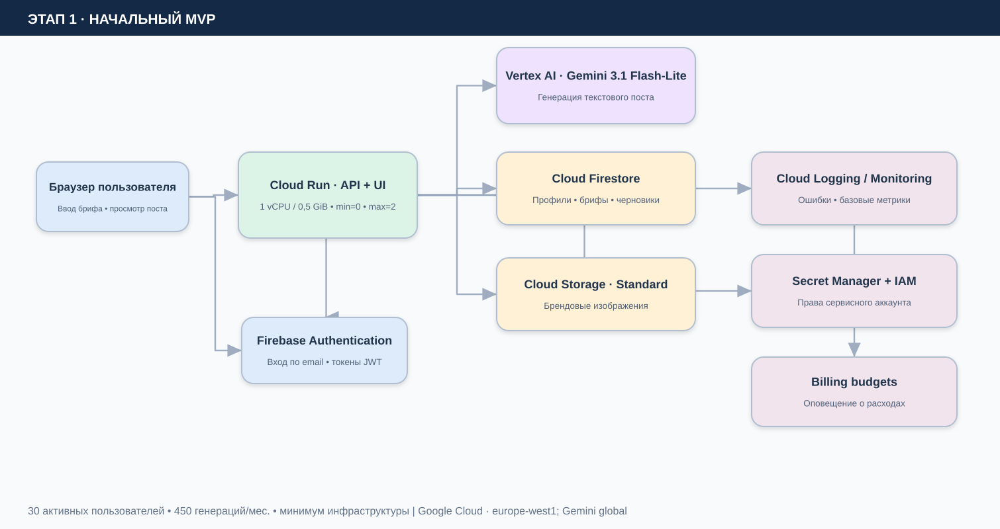
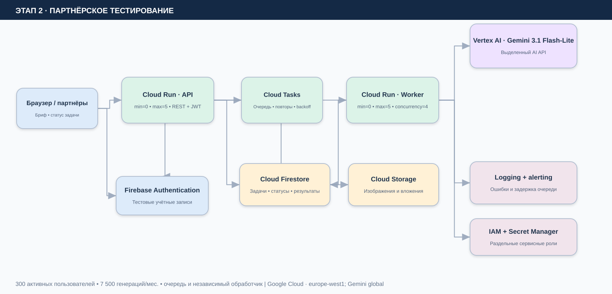
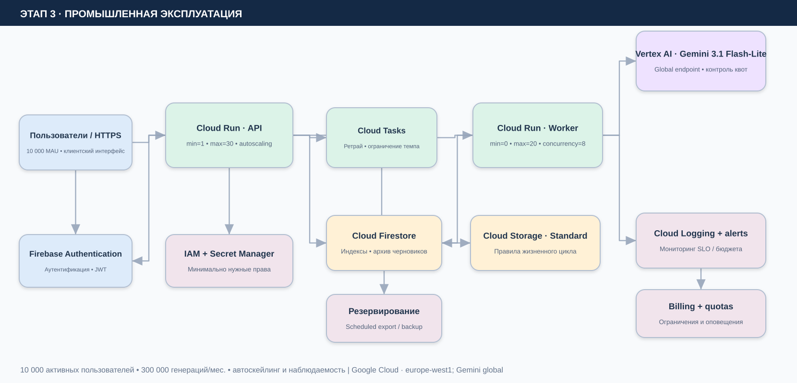

# Лабораторная работа №4

**«Разработка инфраструктуры MVP AI-приложения»**

**Университет:** Университет ИТМО  
**Факультет:** ФТМИ  
**Дисциплина:** Облачные платформы как основа технологического предпринимательства  
**Студент:** Соложенкина Елизавета  
**Группа:** U4225  
**Дата:** 26.10.2026

## 1. Цель и постановка задачи

Спроектировать облачную инфраструктуру AI-приложения для трёх этапов развития: первоначальный MVP, тестирование партнёрами, промышленная эксплуатация. Подобрать облачные сервисы, показать потоки данных и взаимодействия компонентов, оценить ежемесячную и годовую стоимость по проверяемым тарифам, объяснить решения и условия масштабирования. **По заданию реальные облачные ресурсы не создаются.**

**Допущение:** преподаватель не предоставил отдельный набор параметров и нагрузок. Поэтому все сведения о пользователях, объёмах и продукте ниже — явно обозначенный учебный сценарий, а не измерения реально работающего сервиса.

## 2. Концепция продукта

**PostPilot AI** — веб-сервис для подготовки черновиков публикаций в Telegram и социальных сетях. Пользователь входит в аккаунт, вводит тему, целевую аудиторию, стиль и ограничения; система формирует текст с помощью Gemini, сохраняет бриф и результат. При желании можно загрузить иллюстрации и материалы бренда. Сервис создаёт **текст**, но не генерирует изображения: это исключает необходимость в дорогих GPU-инстансах и отдельной модели генерации картинок.

Типовая последовательность: авторизация → отправка брифа → проверка входных полей → вызов ИИ → сохранение черновика → просмотр и редактирование результата. На этапах 2–3 генерация асинхронная: API ставит задачу в очередь, worker получает её, вызывает ИИ и записывает статус в базу.

**Ограничение безопасности:** пользователь видит только собственные черновики. API проверяет JWT и идентификатор пользователя; сервисные аккаунты получают минимально необходимые IAM-права. Брифы не должны содержать секретов, паролей или необработанных персональных данных.

## 3. Допущения по росту и нагрузке

| Показатель | MVP | Партнёрское тестирование | Продакшен |
|---|---:|---:|---:|
| Активных пользователей за месяц, MAU | 30 | 300 | 10 000 |
| Генераций на одного пользователя за месяц | 15 | 25 | 30 |
| **Пользовательских генераций за месяц** | **450** | **7 500** | **300 000** |
| Плюс оплачиваемые повторы / ошибки | 10% | 10% | 10% |
| Суммарно обращений к модели (оценка) | 495 | 8 250 | 330 000 |
| Входных токенов на обращение | 1 000 | 1 000 | 1 000 |
| Выходных токенов на обращение | 750 | 750 | 750 |
| Время Cloud Run на обращение, с | 8 | 8 | 8 |
| Документы Firestore, GiB | 0,3 | 2 | 20 |
| Медиафайлы в Cloud Storage, GiB | 5 | 30 | 200 |
| Интернет-трафик в месяц, GiB | 2 | 30 | 500 |
| Логи в месяц, GiB | 2 | 10 | 60 |

**Ключевое допущение для расчёта:** нагрузка растёт по числу платных обращений к LLM; повторное обращение увеличивает расходы. Скорость генерации, длина промптов, трафик и хранимый объём в реальности могут отличаться. Регион основных сервисов — **europe-west1 (Бельгия)**, а для Gemini выбран **global endpoint**: это экономичное решение, но оно не гарантирует региональную привязку обработки данных, поэтому при требовании строгой локализации тариф и размещение модели пересматриваются.

## 4. Схемы инфраструктуры (draw.io)

**Редактируемый исходник всех трёх схем:** [ai_smm_architecture.drawio](diagrams/ai_smm_architecture.drawio). Открыть через [app.diagrams.net](https://app.diagrams.net/) → File → Open from → Device. В файле находятся **три отдельные вкладки**. Изображения ниже созданы на основе той же схемы, не являются скриншотами облачных ресурсов.

### 4.1. Этап I. Начальный MVP

**Почему так:** единственный контейнер Cloud Run обслуживает веб-интерфейс и API и синхронно вызывает Gemini. Режим *min instances = 0* не требует оплаты постоянно запущенного сервера: приложение может уходить в ноль. Firestore хранит структурированные данные (брифы, черновики, профили), Cloud Storage — двоичные файлы; Firebase Authentication выполняет аутентификацию, а IAM ограничивает права контейнера. Цена холодного старта допустима при 30 MAU. Для текущей нагрузки отдельная очередь не нужна.

**Параметры:** Cloud Run 1 vCPU / 0,5 GiB, min 0, max 2; Firestore Native, Standard Storage.

### 4.2. Этап II. Партнёрское тестирование

**Что меняется:** Cloud Run разделён на API и worker, между ними Cloud Tasks. Запрос получает идентификатор, статус «в обработке» хранится в Firestore; worker вызывает Gemini и сохраняет результат. Повторы с экспоненциальной задержкой важны при временных ошибках API, ограничениях квот и пиках активности. Потребители могут получить результат по API, без удержания долгого HTTP-запроса.

**Параметры:** API min 0/max 5; worker min 0/max 5, concurrency 4. Включаются алерты на рост ошибок, длительность задач и очередь. Для предотвращения повторной генерации при повторной доставке нужно использовать **идемпотентный ключ задачи** и проверку статуса до вызова модели.

### 4.3. Этап III. Промышленное решение

**Что меняется:** API остаётся на Cloud Run, но min 1 снижает риск холодного старта; max 30 и отдельный worker с max 20 / concurrency 8 масштабируются независимо. Cloud Tasks сглаживает всплески; в Firestore используются необходимые индексы; в Cloud Storage — жизненный цикл файлов. Cloud Logging и Monitoring поддерживают алерты по ошибкам, p95 времени ответа API, возрасту задачи, использованию квот и стоимости. Настраиваются резервное копирование и проверка восстановления.

**Важный предел:** автоматическое масштабирование Cloud Run **не увеличивает автоматически квоты модели Gemini**. На продакшене требуется отдельно проверить quota/rate limits Vertex AI и ограничить скорость обработки очереди. Для масштабирования Firestore понадобятся корректные индексы и распределённые ключи документов.

## 5. Экономическая модель

**Единицы:** доллары США, ориентировочная стоимость полного месяца (30 суток); без налогов и курсовой конвертации. **Тарифы** проверены на официальных страницах Google Cloud 26.10.2026. Стоимость Google Cloud зависит от региона, режима биллинга и реального трафика; здесь — сценарный бюджет, не коммерческое предложение провайдера.

Пример расчёта Gemini для одной генерации без повторов:

`(1 000 / 1 000 000) × $0.25 + (750 / 1 000 000) × $1.50 = $0.001375`

В расчёт добавлено 10% оплачиваемых повторов. Cloud Run оценён по 8 секундам на обращение, 1 vCPU и 0,5 GiB RAM, т.е. только переменная часть:

`8 × ($0.000024 + 0.5 × $0.0000025) = $0.000202 за обращение`

Все строки поддаются проверке и изменению в [economic_model.xlsx](economic_model.xlsx) (вкладки «Сводка», «Допущения», «Расчёт»). Стоимость обращения к LLM — крупнейший переменный расход.

| Расход, USD / месяц | MVP | Партнёры | Продакшен |
|---|---:|---:|---:|
| Gemini 3.1 Flash-Lite | $0.68 | $11.34 | $453.75 |
| Cloud Run: CPU | $0.10 | $1.58 | $63.36 |
| Cloud Run: память | $0.00 | $0.08 | $3.30 |
| Cloud Run: запросы | $0.00 | $0.01 | $0.40 |
| Cloud Run: min instance | $0.00 | $0.00 | $9.72 |
| Firestore: чтение | $0.00 | $0.02 | $0.79 |
| Firestore: запись | $0.00 | $0.02 | $0.89 |
| Firestore: хранение | $0.04 | $0.30 | $3.00 |
| Cloud Storage: хранение | $0.10 | $0.60 | $4.00 |
| Интернет-трафик | $0.24 | $3.60 | $60.00 |
| Cloud Tasks | $0.00 | $0.00 | $0.00 |
| Cloud Logging | $0.00 | $0.00 | $5.00 |
| Secret Manager | $0.00 | $0.00 | $0.00 |
| **Подытог** | **$1.17** | **$17.56** | **$604.21** |
| Резерв на неопределённость, 15% | $0.18 | $2.63 | $90.63 |
| **ИТОГО в месяц** | **$1.34** | **$20.20** | **$694.84** |
| **ИТОГО в год ×12** | **$16.13** | **$242.36** | **$8338.08** |

Резерв 15% — **наше учебное допущение**, а не плата Google Cloud. При неизменных предпосылках годовая стоимость = 12 × месяц; инфляция, рост пользователей и сезонные пики отдельно не моделируются.

### Уточнение бесплатных квот и платежей

- **Cloud Run:** фактический счёт может быть ниже, поскольку есть месячный Free Tier (CPU, память, запросы). Чтобы бюджет не зависел от того, используются ли квоты другими проектами на том же биллинге, в расчёте берётся **валовая цена** без вычитания этой льготы. Для min=1 заложена полная месячная стоимость резерва неактивной инстанции, поэтому возможен небольшой запас/двойной учёт при активной нагрузке.
- **Firestore:** чтения, записи и хранение показаны по валовому тарифу, также без вычета Free Tier. Оплачиваемые индексы и резервные копии **не оценены отдельно** и должны добавляться после выбора конкретной политики хранения.
- **Cloud Tasks:** по тарифу первые 1 000 000 операций бесплатно; одна задача предполагает как минимум создание и доставку, поэтому использованы 2 операции на генерацию. На всех трёх этапах в пределах сценария доплаты нет, даже с 10% ретраев.
- **Cloud Logging:** первые 50 GiB журналов за месяц на проект бесплатно, свыше — ориентир $0.50/GiB; длинное хранение сверх включённого периода оценивается дополнительно.
- **Secret Manager:** предполагаются 2 активные версии, что попадает в бесплатные 6, при небольшом числе обращений за секретом. **Не следует вызывать Secret Manager при каждой генерации**, иначе расходы на доступ могут вырасти.
- **Трафик:** $0.12/GiB — плановый ориентир для интернет-исходящего трафика в регионе. Реальная цена зависит от направления, объёма и использования CDN; внутрисервисную передачу внутри региона не следует считать как интернет-egress.
- **Не включены:** домен, платный CDN/WAF, расширенная техподдержка, НДС, разработка, часы инженера, платные бэкапы/PITR и CI/CD, если они потребуют оплаты; потребуются самостоятельные оценки.

## 6. Оптимальность и пороги перехода

| Критерий | Начало | Партнёры | Продакшен |
|---|---|---|---|
| Организация выполнения | Одна синхронная служба | API + асинхронный worker | API + очередь + worker с независимым масштабированием |
| Доступность | Холодный старт допустим | Таймауты/повторы и статусы | Min 1 для API, алерты, backoff |
| Отказоустойчивость | Повтор пользователем | Идемпотентность, очередь и retry | Квоты, DLQ/обработка безнадёжных задач, резервирование |
| Расходы | Избежать простоя ВМ | Только фактическое время исполнения | Платить за стабильный API и наблюдаемость |
| Главный риск | Ошибки промпта | Повторная обработка | Квоты модели и всплески стоимости |

**Почему не виртуальная машина или Kubernetes?** Для такого учебного продукта нет постоянной фоновой нагрузки, собственной модели и необходимости администрировать узлы. Cloud Run упрощает развёртывание и автоматически масштабируется. **Почему не максимально дешёвый монолит навсегда?** Асинхронная обработка позволяет разграничить API и долгие обращения к LLM, контролировать скорость и повторные попытки без истощения пользовательских HTTP-соединений. Базовые компоненты (Firestore, Storage, IAM, модель) сохраняются при переходе между этапами, что сокращает миграционные затраты.

**Сверка пиков:** в продакшене 300 000 генераций / 30 дней ≈ 10 000 в сутки и ≈ 0,116 в секунду в среднем. При условном пиковом множителе 15 — ≈ 1,74 генерации/с. Если worker выполняет одну задачу 8 секунд, нужен минимум ≈ 14 одновременно выполняемых задач; при concurrency=8 это около двух инстанций в пик. Лимит max=20 оставляет запас для неравномерности нагрузки, **но** нельзя считать его гарантией при внешней квоте Vertex AI.

### Чувствительность бюджета

Для базового продакшен-сценария увеличение **длины выходного текста с 750 до 1 500 токенов** повышает расходы именно на Gemini ещё на $371.25 в месяц до резерва; это больше, чем стоимость всей базы Firestore. Поэтому полезны лимит максимального количества токенов, кэширование неизменных справочных данных (где это применимо), контроль отказов и мониторинг реальной длины ответа. В работе не предполагается гарантированная экономия на кэше — она зависит от модели и характера запросов.

## 7. Риски и меры контроля

1. **Перерасход:** включить Billing Budgets, ежедневные алерты, ограничение длины ответа, квоты по пользователю и сервису. Бюджетное уведомление **само по себе не выключает расходы**, поэтому нужны активные лимиты в коде и конфигурации.
2. **Повторная задача:** уникальный идентификатор, транзакционная проверка состояния в Firestore перед Gemini; результат не должен оплачиваться дважды из-за повторной доставки задачи.
3. **Недоступность Vertex AI:** обработка 429/5xx, ограниченный retry и отображение честного статуса ожидания/ошибки пользователю.
4. **Защита контента:** Firebase Auth и проверка прав в API, IAM по принципу минимальных полномочий, закрытый бакет, подписанные URL при необходимости; не делать изображения пользователя публичными по умолчанию.
5. **Хранение данных:** политика сроков хранения, удаление пользовательских черновиков и медиа, ограничение содержимого логов, резервное копирование с тестом восстановления.

## 8. Результат работы

Спроектированы **три архитектуры** в одном редактируемом draw.io файле, создана **модель расходов в Excel с формулами и изменяемыми исходными данными**, выбран путь эволюции без переписывания стека при росте нагрузки. Для заданного учебного сценария месячный бюджет с 15% резервом составляет ориентировочно: MVP — **$1.34**, пилот — **$20.20**, продакшен — **$694.84**. Стоимость условна: реальные значения зависят от длительности обработки, размера текстов и трафика. **Облачные ресурсы по условиям лабораторной не создавались.**

## 9. Источники (официальные тарифы)

1. Google Cloud — [Gemini / Vertex AI Generative AI pricing](https://cloud.google.com/gemini-enterprise-agent-platform/generative-ai/pricing) (Gemini 3.1 Flash-Lite, global text input/output).
2. Google Cloud — [Cloud Run pricing](https://cloud.google.com/run/pricing) (Tier 1, CPU, RAM, requests, idle instances, Free Tier).
3. Google Cloud — [Cloud Firestore pricing](https://cloud.google.com/firestore/pricing) (documents / operations / storage).
4. Google Cloud — [Cloud Storage pricing](https://cloud.google.com/storage/pricing) (Standard class, single region).
5. Google Cloud — [Cloud Tasks pricing](https://cloud.google.com/tasks/pricing) (first 1 million operations).
6. Google Cloud — [Observability pricing](https://cloud.google.com/products/observability/pricing) (Cloud Logging).
7. Google Cloud — [Secret Manager pricing](https://cloud.google.com/secret-manager/pricing) (six active versions free).
8. Google Cloud — [Virtual Private Cloud network pricing](https://cloud.google.com/vpc/pricing) (ориентир по интернет-egress).

*Дата обращения к тарифам: 26 октября 2026 г. Для реального бюджета рекомендуется повторить оценку в актуальном Google Cloud Pricing Calculator.*
